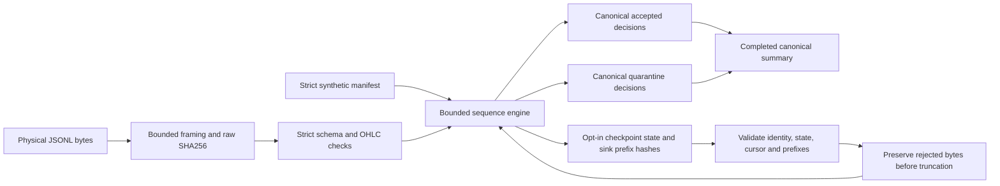

# Case study: bounded integrity and conservative crash recovery

This is an independent synthetic portfolio sample, created with AI assistance.
The observable result is source code, reproducible behavior and finite local
measurements. It does not establish employer results, individual code share,
market-feed completeness, production suitability or trading profitability.

## Problem and architecture

A physical record can be malformed, oversized, out of order, duplicated or
interrupted while its decision is being written. The lab keeps those questions
separate: framing and provenance first, explicit stream/sequence rules second,
then opt-in recovery of the same decisions.

Each decision records physical offset, length, line and raw hash. Normalized
payloads drive sequence comparison. Raw identity and normalized equality answer
different questions; neither is a certificate that source data is authentic.

A1 streams oversized input without retaining the whole line. A2 retains only
the last W consumed sequence values per declared stream, with K*W<=65536.
Output size still grows with input. These retention caps do not imply a fixed
process working set.

## State decisions that matter

| Input condition | Decision |
| --- | --- |
| Expected sequence, valid OHLC | Accept, consume, retain normalized payload |
| Expected sequence, bad OHLC | Quarantine, consume, retain; later comparison remains possible |
| Same normalized payload inside retained window | Duplicate; do not consume again |
| Different payload for retained sequence | Conflict; block that stream |
| Ahead of expected sequence | Gap; block that stream |
| Older than retained window | Stale outside window; duplicate status is unknown |
| Malformed or undeclared envelope | Quarantine; preserve unattributed/UNKNOWN assessment |
| Maximum Int64 sequence consumed | Terminal range; no overflow or invented next sequence |

A different declared stream continues when one is blocked. No calendar,
backfilled reset, reordering or heuristic repair silently heals a gap. An
observed prefix is not complete-feed evidence.

## Recovery choices and tradeoffs

Two alternating committed slots preserve one prior generation. Decisions are
flushed before the checkpoint is published. A raw physical cursor avoids using
the reader's buffered stream position. Checkpoints carry the entire retained
window, counters, blocked state, identities and exact sink prefixes.

Resume validates candidates independently. A corrupt candidate may fall back
only to another eligible candidate. Missing/duplicate/incompatible critical
identity is fatal, even if another slot looks usable. A checksum detects
corruption; it is not authentication.

Before trimming uncommitted tails or replacing rejected state, recovery copies
the relevant bytes to a bounded evidence store. Exhaustion or copy failure
leaves active data unchanged. This costs storage and can require manual archive.
It intentionally refuses an automatic destructive cleanup.

The tested failure model is owned process interruption on supported local
filesystems with enabled .NET locking and cooperating writers. Unix locking is
advisory. Disabled locks, power loss, hostile mutation, network filesystems and
distributed exactly-once delivery are outside the guarantee.

## Failures that changed the implementation or proof

The [development receipts](evidence/development/index.json) are local pre-release runs. They are not
historical GitHub CI or independent reproduction of the pre-fix binaries.
The published final tests make the fixed behavior reproducible.

| Observation | Correction | Evidence level |
| --- | --- | --- |
| EOF finalization advanced generations without new rows; 2/2 targeted cases failed | Track dirty records, reuse committed EOF and enforce generation<=records | Product defect; local red/green receipts and final regression |
| Ambiguous policy identity allowed fallback; 1/6 targeted cases failed | Validate critical identity uniqueness and compatibility before fallback | Product defect; verified local red/green and final regression |
| Harness tried reading sinks held exclusively by its own live writer | Observe closed checkpoint bytes and readable metadata, retain production lock | Harness observation error; not evidence of broken ownership |
| Partial checkpoint cut had no physical half-payload because it was buffered | Probe-only flush and exact physical-length assertion before kill | Proof gap; stronger test, no claimed production durability upgrade |
| First identity mutation fixture did not create the intended duplicate property | Assert the mutation itself; exclude that run from product-red evidence | Invalid fixture, explicitly excluded |

The finite kill matrix includes partial decisions, flushed sinks, partial and
flushed pending checkpoints, committed slots and summary publication. Repeated
restarts, ineligible fallback, evidence-copy failure/budgets and real CLI exits
are checked. The A3 release passed 80 fixed C# cases on Windows and Linux.
Those checks support the named cases; they are not exhaustive crash-state proof.

## Resource reasoning

Retention is bounded at each layer: R-byte record capture, K declared streams,
W normalized consumed values, fixed checkpoint/summary caps, and a separate
192 MiB/32-file evidence store. A serializer-bound test constructed all 65,536
retained slots and produced a 20,381,725-byte checkpoint within the 64 MiB payload
cap; a conservative 4,096-stream maximum-counter summary shape was 1,253,963
bytes within 4 MiB. These are concrete shape/serialization checks, not
measurements of total process memory or a real maximum-size feed workload.

Historical comparisons scan at most W entries. Checkpoint state serialization
scales with retained state, and durable flush calls can dominate mode cost.
The code chooses explicit bounded state and conservative refusal over inferred
repair. The finite study uses K=16/W=64, far below the retention cap, so its
results must not be extrapolated to maximum-window workloads.

## Measurements

One approved study completed all 18 validation children and 3 separate hash
references in 33.969 seconds, retaining 575,034,319 bytes including the final
receipt. Limits were 600 seconds / 2 GiB; no failure, retry, tuning or replacement
occurred. Every validation matched expected counters/reasons and the three
canonical files of its size's A2 reference. Source, built files, executable and
workload hashes matched before/after.

Measured code: [d9ece502](https://github.com/pouriaquant91/market-data-integrity-lab/commit/d9ece5023487155a85050ec6fb0dae5f344d8de7),
tree 20bea427f7efd172cd08f40b03e91c52675c306b. Later results/docs are a separate
release commit, not a claim that a later binary was timed. Recorded worker DLL
SHA256 is 5a780c780e190bb0ba94e92141588284c2ba906640e3d69a913b96f8cf9cfdc9;
Integrity.dll SHA256 is 87e0dcaa826839d8764532c5e74c25579e7b0918f3f5d95bd0e51d4c38211e10.
Raw receipts list every built file, source fingerprint, SDK host hash and input
identity. The final application and measurement-worker/driver source bytes
remain identical to this measured ancestor; documentation and analysis are added.

Host: Windows build 10.0.26300, AMD64, Intel i9-11900K @ 3.50GHz,
16 logical cores, 34,112,135,168 OS-visible RAM bytes; Python 3.12.10,
SDK 10.0.403 and .NET 10.0.14. Stopwatch frequency is recorded per sample.
File locking was enabled. No host isolation, affinity or cache eviction;
generation and output verification may warm caches. Fresh processes do not
inherit application JIT state. These are one-host observations.

| Physical rows | Mode | Samples | Operation seconds min / median / max | Median rows/s | Managed allocation MiB (median) | Lifetime peak MiB (median) |
| ---: | --- | ---: | --- | ---: | ---: | ---: |
| 10,000 | A2 | 3 | 0.264309 / 0.267010 / 0.280666 | 37,452 | 41.86 | 46.17 |
| 10,000 | A3 | 3 | 0.500224 / 0.501256 / 0.513251 | 19,950 | 81.08 | 50.18 |
| 100,000 | A2 | 3 | 1.559165 / 1.625009 / 1.632810 | 61,538 | 411.91 | 48.02 |
| 100,000 | A3 | 3 | 2.698628 / 2.720216 / 3.087811 | 36,762 | 797.79 | 61.97 |
| 250,000 | A2 | 1 | 2.569025 (single) | 97,313 | 1017.95 | 52.99 |
| 250,000 | A3 | 1 | 5.248748 (single) | 47,630 | 1976.02 | 61.69 |

The A3 operation median was about 1.88x A2 at 10k and 1.67x at 100k.
The single 250k observation was about 2.04x. A3 cumulative managed allocation
was about 1.94-1.95x A2. This is an unfavorable cost observation retained without
tuning: the two complete modes include different writer/flush/checkpoint paths,
so it does not isolate checkpoint causality.

Allocated bytes accumulate over execution, not concurrently retained memory.
For example, A3 at 250k allocated about 1,976.02MiB cumulatively while its reported
lifetime peak working set was 61.69MiB. Neither is an operation-only heap peak.
Peak is collected before metric serialization/exit, so a small final process tail
is unobserved. No zero/unsupported peak occurred here; such values remain UNKNOWN.

Regular cells contain 3 samples; min/max are observed spread, not confidence
intervals or tail latency. Stress cells contain 1 observation and provide no
spread estimate. Throughput uses all physical rows, including quarantined rows.
The 250k A2 rate exceeded its 100k rate; startup/JIT/cache/host effects prevent a
linear scaling claim. K=16/W=64 is far below the maximum retention shape.

The 3 SHA256-only references are separately retained in raw results; none was
subtracted from validation time or used as actual in-run phase duration.
CPU, parent launch-to-exit wall, source-byte throughput and every individual
sample remain in the [computed summary](evidence/measurements/summary.json)
and [raw receipt](evidence/measurements/results.json).
[Definitions and exact finite schedule](MEASUREMENTS.md) explain the windows.
Recompute receipt arithmetic without running new measurements:

~~~sh
python tools/analyze_measurements.py docs/evidence/measurements artifacts/recomputed-summary.json
~~~

The analyzer creates its output parent directory and checks the published
summary if present. It imports no driver helpers. It independently checks counts, schedule totals, metric arithmetic,
cross-mode hashes and the source-before/after match. Complete retained datasets
and per-child output are private; compact reviewed raw metrics and canonical
hashes are public. A new study would create new data, not re-execute this receipt.

## Ownership and attribution

Only newly generated synthetic input is used. Shared private implementation,
fixtures, schemas, account/market data and product rules are excluded.
The sample uses general integrity/recovery concepts; overlap with unavailable
private repositories remains UNKNOWN. No novelty or legal-clearance claim is
made. AI assistance is explicit; the repository does not independently assess
the owner's unaided implementation ability.
